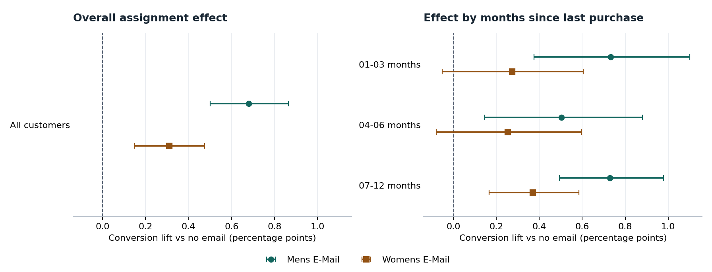

# Marketing Causal Analytics

## Overview

How many people buy because a store sent them a promotional email? This project uses a three-group randomized experiment to estimate how many purchases each email generated, how much the store could spend per customer, and whether the evidence supports targeting different customer groups.

> For a plain-language introduction, read the [two-minute project brief (PDF)](project-brief.pdf).

The primary metric is the **purchase rate within two weeks of assignment**, measured across everyone assigned to each group. Website visits provide context, and spending per customer is used to estimate incremental revenue. The analysis compares each email with the no-email group and directly compares the two email versions.

## Main Takeaways

| Assignment | Buyers / Customers | Purchase rate | Lift vs. no email (percentage points, 95% CI) |
| --- | ---: | ---: | --- |
| No email | 122 / 21,306 | 0.573% | Control |
| Men's email | 267 / 21,307 | 1.253% | **+0.681** [0.501, 0.864] |
| Women's email | 189 / 21,387 | 0.884% | **+0.311** [0.150, 0.475] |

- **The men's email produced the larger increase.** Per 10,000 assigned customers, it generated an estimated 68 additional buyers, compared with 31 for the women's email. In the head-to-head comparison, the men's email led by 0.369 percentage points, with a 95% confidence interval of [0.175, 0.566]. [Overall results](reports/overall_effects.csv)
- **The evidence is too weak to target by time since the last purchase.** The tests did not detect differences in absolute lift across the 1-3, 4-6, and 7-12 month groups for either email. [Segment effects](reports/segment_effects.csv) · [Tests for differences across segments](reports/heterogeneity.csv)
- **Incremental revenue sets the budget ceiling.** At an assumed 40% contribution margin, estimated break-even cost per assigned customer is US$0.308 for the men's email and US$0.170 for the women's email. The budget table spans contribution margins of 25%, 40%, and 60%, and all-in costs of US$0.02, US$0.10, US$0.20, and US$0.45 per person. [Budget scenarios](reports/budget_scenarios.csv)



## Data

The sole raw input is `data/raw/hillstrom.csv.gz`, a copy of the retail email experiment Kevin Hillstrom released through MineThatData in 2008. It has **64,000 rows and 12 fields**, with one row per customer who bought something in the previous 12 months. The analysis uses `segment` to identify randomized assignments, `conversion` to measure the primary outcome, and `recency` to group customers using information recorded before assignment. [Original experiment description](https://blog.minethatdata.com/2008/03/minethatdata-e-mail-analytics-and-data.html) · [Source and data notes](data/README.md)

| Field | When measured | Definition and use |
| --- | --- | --- |
| `segment` | At assignment | `Mens E-Mail`, `Womens E-Mail`, or `No E-Mail` |
| `conversion` | Two weeks after assignment | Whether the customer purchased, 0 or 1. Primary outcome |
| `visit` | Two weeks after assignment | Whether the customer visited the website, 0 or 1. Secondary outcome |
| `spend` | Two weeks after assignment | Customer spending in US dollars, including zeros. Used to estimate revenue and budget thresholds |
| `recency` | Before assignment | Months since the last purchase. Used to define groups and check balance |
| `history` | Before assignment | Spending over the prior 12 months. Used to check balance |
| `history_segment` | Before assignment | Prior spending bracket |
| `mens`, `womens` | Before assignment | Whether the customer bought men's or women's merchandise in the prior 12 months. Both can be 1 |
| `newbie` | Before assignment | Whether the customer was new in the prior 12 months |
| `zip_code` | Before assignment | Area category based on ZIP code |
| `channel` | Before assignment | Purchase channel over the prior 12 months |

The dataset does not include customer IDs or actual campaign costs. The analysis retains rows with identical field values because different customers can share those values. Git excludes the raw file, so download it separately after cloning.

## Method

1. **Validate the data and assignments.** Check the SHA-256 hash, schema, missing values, and consistency across outcomes. Aggregate customer counts, purchases, visits, and spending independently in SQLite and pandas, then reconcile overall and segment totals. Use a chi-square test to check the 1:1:1 allocation and standardized mean differences to compare pre-assignment characteristics against the control group.
2. **Estimate purchase lift by original assignment.** Use intention-to-treat (ITT) analysis, which includes every assigned customer. Absolute lift is the difference in purchase rates. Relative lift divides that difference by the comparison group's rate. Use a two-sided two-proportion z-test and Newcombe-Wilson 95% confidence intervals. Apply the Holm adjustment to the three overall comparisons.
3. **Test for differences across groups.** Within each `recency` group, estimate the difference in purchase rates between each email and no email. Use a Wald test to check whether the same email's effect varies across the three groups. Apply Holm separately to the within-group comparisons and the two overall heterogeneity tests. Confidence intervals are estimated separately for each comparison.
4. **Translate revenue lift into a campaign cost ceiling.** Estimate incremental revenue from the difference in average spending per assigned customer, with a Welch 95% confidence interval. Multiply incremental revenue per customer by the assumed contribution margin to get the break-even cost. Deduct the all-in campaign cost per customer to estimate net contribution and its interval per 1,000 customers. [Quality checks](reports/quality_checks.json) · [Decision report](reports/decision.md)

Hillstrom contains customer characteristics from before assignment and outcomes for the two weeks afterward. A difference-in-differences (DiD) extension would need a separate dataset with the same outcome measured before and after an intervention in both the treated and comparison groups. [Causal Inference for the Brave and True](https://matheusfacure.github.io/python-causality-handbook/landing-page.html)

## Repo Structure

| Path | Contents |
| --- | --- |
| [data/](data/) | Data sources and field definitions. Place the local download in `data/raw/` |
| [sql/summary.sql](sql/summary.sql) | SQLite summaries of counts and outcomes by assignment and customer group |
| [scripts/analyze.py](scripts/analyze.py) | Validates the data, reconciles SQLite and pandas totals, and produces results and a chart |
| [scripts/build_tableau.py](scripts/build_tableau.py) | Packages analysis results into a Tableau workbook |
| [reports/](reports/) | Decision report, quality checks, purchase-lift chart, and result CSVs |
| [tableau/](tableau/) | Packaged Tableau workbook and worksheet guide |
| [requirements.txt](requirements.txt) | Python dependencies |

## How to Run

The instructions below use Windows PowerShell, Git, and Python 3.10 or later.

### 1. Clone the repository

Open PowerShell in the parent folder where you want to save the project, then enter the repository's remote URL.

```powershell
$repoUrl = Read-Host "Enter the Git remote URL"
git clone $repoUrl marketing-causal-analytics
Set-Location marketing-causal-analytics
```

If the cloned repository contains several projects, run `Set-Location "marketing casual analytics"` to enter this one. If you already have a local copy, open the directory that contains `requirements.txt` and `scripts/`, then go to the next step.

### 2. Create a virtual environment and install dependencies

```powershell
python --version
python -m venv .venv
.\.venv\Scripts\python.exe -m pip install -r requirements.txt
```

The remaining commands use the virtual environment's Python executable.

### 3. Download the experiment data and verify the checksum

```powershell
New-Item -ItemType Directory -Force -Path data/raw | Out-Null
curl.exe --fail --location "https://hillstorm1.s3.us-east-2.amazonaws.com/hillstorm_no_indices.csv.gz" --output data/raw/hillstrom.csv.gz
if ($LASTEXITCODE -ne 0) { throw "Hillstrom data download failed" }
$expected = "bab6578f60db5d792f1c2372c502f029152a5249cf5ea84390f3b7f885d7234f"
if ((Get-FileHash -Algorithm SHA256 data/raw/hillstrom.csv.gz).Hash -ne $expected) {
    throw "Hillstrom data SHA-256 mismatch"
}
```

The download uses the public mirror listed by scikit-uplift. Keep the `.csv.gz` extension so the analysis script can read the compressed file directly. [Mirror and version details](data/README.md#download-and-verify)

### 4. Run the analysis and build the Tableau workbook

```powershell
.\.venv\Scripts\python.exe scripts/analyze.py
.\.venv\Scripts\python.exe scripts/build_tableau.py
```

The first script prints `Analyzed 64,000 customers. SQL and Pandas summaries reconcile.` and writes the result files and chart to `reports/`. The second script packages the results into [Marketing Causal Analytics.twbx](tableau/Marketing%20Causal%20Analytics.twbx). Read the [decision report](reports/decision.md) for the analysis, or open the workbook in Tableau Desktop and select **Campaign decision**.

## Summary

The next test prioritizes the men's email with a 1:1 random split of eligible current customers and a no-email control group. The plan sets the sample size, observation window, and unsubscribe and complaint monitoring, then uses the purchase-rate and net-contribution intervals to decide whether to expand the campaign. [Experiment plan](reports/decision.md#experiment-plan)
