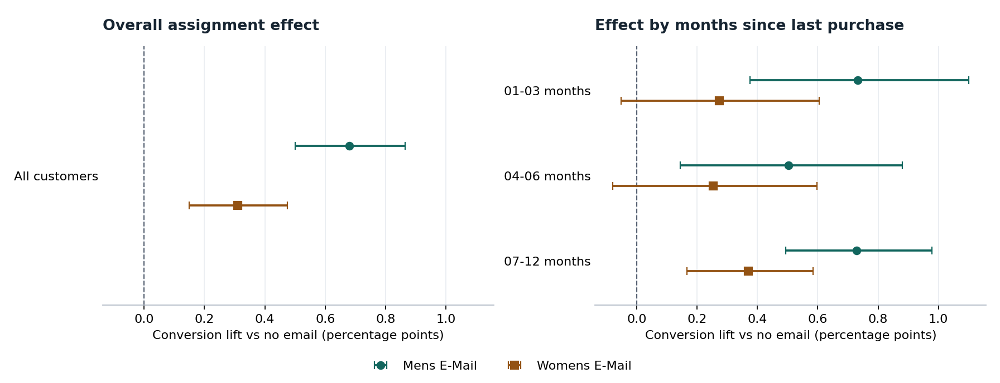

# Promotional Emails Increased Purchases. Retest the Men's Version First.

MineThatData retail experiment · Released in 2008 · 64,000 previous customers · Two weeks of follow-up

## Decision Summary

**Prioritize a randomized retest of the men's email with a no-email control group.** The no-email group's purchase rate was 0.573%. It rose to 1.253% in the men's email group, an increase of 0.681 percentage points, and to 0.884% in the women's email group, an increase of 0.311 points. The direct comparison put the men's version 0.369 points ahead of the women's version, with a 95% confidence interval of [0.175, 0.566]. [Original experiment](https://blog.minethatdata.com/2008/03/minethatdata-e-mail-analytics-and-data.html) · [Overall results](overall_effects.csv) · [Retest design](#experiment-plan)

The historical experiment also showed an increase in revenue. At a 40% contribution margin, the estimated break-even cost for the men's email was **US$0.308 per assigned customer**, with a lower bound of **US$0.194** based on the 95% confidence interval for the revenue effect. The decision to expand depends on the incremental contribution and actual all-in cost measured in the new test. [Budget scenarios](budget_scenarios.csv)

## The Men's Email Added About 68 Buyers per 10,000 Customers

| Assignment | Customers | Buyers | Purchase rate | Website visit rate | Spending per customer |
| --- | ---: | ---: | ---: | ---: | ---: |
| No email | 21,306 | 122 | 0.573% | 10.62% | US$0.65 |
| Men's email | 21,307 | 267 | 1.253% | 18.28% | US$1.42 |
| Women's email | 21,387 | 189 | 0.884% | 15.14% | US$1.08 |

| Comparison with no email | Purchase-rate difference (percentage points) | 95% CI | Relative lift | Additional buyers at observed group size (95% CI) | Holm-adjusted p-value |
| --- | ---: | --- | ---: | --- | ---: |
| Men's email | +0.681 | [0.501, 0.864] | +118.8% | About 145 [107, 184] | 4.57e-13 |
| Women's email | +0.311 | [0.150, 0.475] | +54.3% | About 67 [32, 101] | 0.000314 |

Relative lift uses the no-email purchase rate of 0.573% as the baseline. The women's email added about 31 buyers per 10,000 assigned customers. The estimated number of additional buyers at the observed group size is the purchase-rate difference multiplied by the number of customers assigned to that email. [Assignment summary](arm_summary.csv) · [All comparisons](overall_effects.csv)

## The Evidence Is Too Weak to Target by Time Since Last Purchase

| Months since last purchase | No-email purchase rate | Men's lift, percentage points (95% CI) | Women's lift, percentage points (95% CI) |
| --- | ---: | --- | --- |
| 1-3 months | 0.901% | +0.733 [0.375, 1.099] | +0.275 [-0.052, 0.606] |
| 4-6 months | 0.546% | +0.503 [0.144, 0.880] | +0.254 [-0.079, 0.597] |
| 7-12 months | 0.319% | +0.729 [0.495, 0.978] | +0.370 [0.166, 0.584] |

The men's email had a positive effect in all three groups, each with a Holm-adjusted p-value below 0.05. The women's email also met that threshold in the 7-12 month group. For the direct tests of whether absolute lift varied across the three groups, the Holm-adjusted p-value was 1.00 for each email. The women's email showed higher relative lift among customers who had gone longer without buying, a group that also had a lower baseline purchase rate. Use these exploratory results to plan a retest. [Segment effects](segment_effects.csv) · [Tests for differences across segments](heterogeneity.csv)

## Incremental Revenue and Margin Set the Campaign Cost Ceiling

At the actual sizes of the email groups, the men's email added an estimated **US$16,403** in revenue (95% CI US$10,337 to US$22,469) and the women's email added **US$9,077** (US$3,613 to US$14,540). The estimate uses the average spending of all assigned customers, including zeros for customers who did not buy. [Budget scenarios](budget_scenarios.csv)

| Assumed contribution margin | Men's break-even cost per assigned customer | Women's break-even cost per assigned customer |
| ---: | ---: | ---: |
| 25% | US$0.192 | US$0.106 |
| 40% | US$0.308 | US$0.170 |
| 60% | US$0.462 | US$0.255 |

### Men's Email Under Different Margins and Costs

Each cell shows incremental net contribution in US dollars per 1,000 assigned customers, followed by the 95% confidence interval. The column headings are all-in costs per assigned customer. US$0.02 is the original scenario. The other columns show what happens as campaign costs rise.

| Assumed contribution margin | US$0.02 | US$0.10 | US$0.20 | US$0.45 |
| ---: | ---: | ---: | ---: | ---: |
| 25% | +172 [101, 244] | +92 [21, 164] | -8 [-79, 64] | -258 [-329, -186] |
| 40% | +288 [174, 402] | +208 [94, 322] | +108 [-6, 222] | -142 [-256, -28] |
| 60% | +442 [271, 613] | +362 [191, 533] | +262 [91, 433] | +12 [-159, 183] |

At a 40% margin and US$0.10 cost, the interval stays above break-even. At US$0.20, the estimate is still positive, but the interval includes a loss. At US$0.45, the entire interval is below break-even. Use the same formula with the observed campaign cost and update the revenue estimate after the retest. [All scenarios for both emails](budget_scenarios.csv)

- **Break-even cost per assigned customer** = incremental revenue per customer × contribution margin.
- **Incremental net contribution per 1,000** = 1,000 × (break-even cost per customer − all-in cost per customer). Apply the formula to both interval bounds, keeping the margin and cost fixed within each scenario.
- **For a planned audience size**, multiply the per-customer result by the number of customers to be assigned to the email group. Allocate any one-time production cost across that group and add it to the per-customer send cost. The `customers` field in the CSV gives the historical email group size used to calculate revenue lift at the original scale.

To test other assumptions, edit `BUDGET_MARGINS` and `BUDGET_CONTACT_COSTS_USD`, then rerun the analysis and workbook build. The tables above use the default settings. [Analysis script](../scripts/analyze.py) · [How to Run](../README.md#how-to-run)

## Experiment Plan

**Goal.** Use the current customer list to test whether the men's promotional email increases the two-week purchase rate and whether the additional net contribution supports a wider rollout.

| Design element | Specification |
| --- | --- |
| Eligibility | Include customers who purchased in the prior 12 months and meet current subscription and sending requirements. Remove known bad addresses and unsubscribed customers before assignment, and deduplicate by customer ID. |
| Random assignment | Randomly assign customers 1:1 by ID and save the assignment list. Send the men's promotional email once to the test group. Keep the same usual marketing for both groups and withhold this specific email from the control group. |
| Observation window | Track both groups for 14 days from the same scheduled send time. Analyze once the last customer's window closes and purchase data are complete. |
| Primary metric | Divide the number of customers who purchased at least once within 14 days by all customers assigned to the group. Analyze by original assignment (ITT), including people whose emails could not be delivered. |
| Financial outcome | Compare average merchandise contribution per assigned customer across groups, then deduct the all-in campaign cost per customer. Estimate incremental net contribution with a 95% confidence interval. Reconcile discounts and posted refunds so they are counted once. |
| Quality and risk checks | Before sending, verify the list, the assignments, and the connection between purchase events and customer IDs. Monitor assignment proportions, unsubscribes, spam complaints, and failed deliveries. Set limits before launch using current baseline rates and the sending platform's thresholds. |

**Sample size.** The historical control rate was 122 / 21,306, or about 0.573%. Using a provisional detectable difference of +0.20 percentage points, a 1:1 split, a two-sided alpha of 0.05, and 80% power, the normal approximation for two proportions gives **26,218 customers per group**, or **52,436 total**. Before launch, recalculate from the current 14-day purchase rate, the smallest difference the business needs to detect, and the available audience. This calculation sizes the test for purchases. Financial outcomes have their own uncertainty. [Two-proportion sample size method](https://www.stata.com/manuals/pss-2powertwoproportions.pdf)

**Run and readout.** Finalize the creative, offer, list, and cost definitions before sending. Pause and investigate if delivery problems occur or risk indicators exceed their limits. Evaluate purchases once the planned sample and observation window are complete. Report absolute lift using a two-sided two-proportion z-test and a Newcombe-Wilson 95% confidence interval. Resolve assignment or purchase-tracking issues before interpreting the result. [Microsoft pre-experiment guidance](https://www.microsoft.com/en-us/research/articles/patterns-of-trustworthy-experimentation-pre-experiment-stage/) · [Monitoring guidance](https://www.microsoft.com/en-us/research/articles/patterns-of-trustworthy-experimentation-during-experiment-stage/)

| Result | Decision |
| --- | --- |
| The 95% intervals for purchase lift and incremental net contribution are both entirely positive, and risk indicators meet the set thresholds | Roll out gradually and keep a small randomized no-email group for ongoing measurement. |
| Purchases increased, but the interval for incremental net contribution includes zero | Hold at the test scale. Reconcile costs and refunds, then consider reducing costs or running another test. |
| Evidence of purchase lift is weak, the financial interval is entirely below zero, or risk indicators exceed their limits | Defer rollout. Review the sample size, campaign costs, or sending quality as appropriate before deciding whether to retest. |

**Status.** The retest has been designed. Launch requires a current eligible list, finalized creative, a sending workflow that records orders and email events, and actual costs, margins, and risk thresholds.

## Data Quality and Inference

- **Data quality.** The source has 64,000 rows, 12 fields, and no missing values. Independent SQLite and pandas summaries agreed on customers, purchases, visits, and spending for every group and segment. The dataset lacks customer IDs. The analysis retained 6,562 rows whose field values matched an earlier row.
- **Assignment check.** Against the published 1:1:1 split, the chi-square test for sample ratio mismatch gave p = 0.904. Across months since last purchase, prior spending, prior purchases of men's and women's merchandise, and new-customer status, the largest absolute standardized mean difference was about 0.009.
- **Inference.** The analysis followed original assignment (ITT). Purchase-rate differences use two-sided two-proportion z-tests and Newcombe-Wilson 95% confidence intervals. Holm adjustment was applied separately to the three overall comparisons, the six exploratory within-segment comparisons, and the two heterogeneity tests. The confidence intervals shown are pointwise and are unadjusted for multiplicity. Heterogeneity was assessed with an overall Wald test of absolute differences across three mutually exclusive segments. Spending differences use Welch 95% confidence intervals.
- **Scope.** The dataset was released in 2008 and covers recent customers of one retailer, followed for two weeks. The results describe that experiment. Current customers, long-term outcomes, and other marketing channels each need their own evidence.

[Data source and reproduction](../data/README.md) · [Quality check results](quality_checks.json) · [Tableau workbook](../tableau/Marketing%20Causal%20Analytics.twbx)
